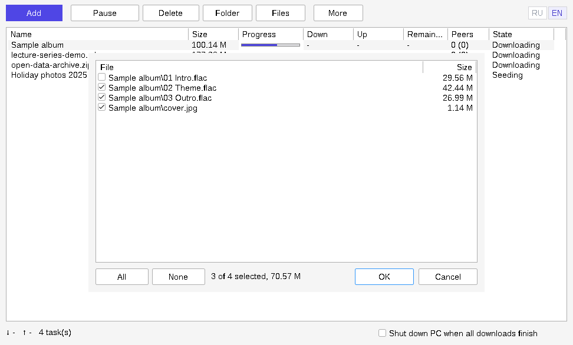

<p align="center"></p>

# LiteTorrent

**English** · [Русский](README.ru.md)

A deliberately small BitTorrent client for Windows: one 9.5 MB `.exe`, no installer, no ads, no settings screen, and a checkbox that shuts the PC down when the downloads are done.




> The screenshots were captured with a Linux build runner, so fonts and window frames look slightly different on Windows.

## Download

Get `LiteTorrent-Windows-x64.zip` from the [Releases](../../releases) page, unpack it and run `litetorrent.exe`. Nothing else is needed next to it.

- Windows 10 or 11, 64-bit.
- The exe is **not code-signed**. SmartScreen will warn about an unknown publisher; choose "More info" → "Run anyway" if you trust this build, or build it yourself (see [Building](#building)).
- From 1.2.0 on, releases are built by [GitHub Actions](../../actions) straight from the tagged commit of this repository, not on anyone's own computer. The release notes link the build log and list the exe's SHA-256, so you can check that the file you downloaded is the one that log produced.

## What it does

- Adds torrents from a magnet link, a `.torrent` file, drag-and-drop onto the window, or "Open with" / double-click in Explorer (the file path is taken from the command line).
- **Opens `.torrent` files and `magnet:` links itself, if you want.** On the first start it asks once; the answer can be changed later under **More**. It registers only for your Windows user, without admin rights. If another program already owns these, Windows does not let any app take over silently: LiteTorrent says so and offers to open Settings → Default apps.
- **Choose which files to download.** Select a torrent and press **Files** to tick or untick files; unticked files are skipped. For a magnet link the list appears once its metadata has arrived. The choice is saved with the torrent.
- **Speed limits.** **More** → *Limit download* / *Limit upload*, a few presets from 512 KB/s to 20 MB/s (upload from 64 KB/s). An active limit is shown in the status bar next to the speed.
- Lets you choose the save folder when adding, and remembers the last one.
- Shows name, size, progress, download and upload speed, time remaining, peers (seeds) and state.
- Pause / resume and delete (with or without the downloaded files) for the selected torrent; "Folder" opens the folder that torrent was saved to.
- **Remembers the task list.** Torrents, their progress and their paused state survive closing the app, a restart, or a crash (progress is saved once a minute and on exit).
- **One running copy.** Opening another `.torrent` while LiteTorrent is running adds it to the existing window instead of starting a second program. Adding a torrent that is already in the list says so.
- **Shut down the PC when all downloads finish.** A window in the middle of the screen, on top of everything, counts down 15 seconds with a "Cancel shutdown" button. It only fires for downloads that were still running after you ticked the box — ticking it over an already-complete list does nothing — and never while a torrent is stopped with an error.
- Russian and English interface, switched by the RU / EN buttons in the top-right corner.

## What it does not do — read this before relying on it

This is a small project and it is honest about its limits:

- **Tested by hand.** The author has run every release on Windows, including the 1.2 additions (file association, the Files window, speed limits). There is no automated test suite, so please report anything odd.
- Files can only be downloaded or skipped: no priorities, no custom queue order, no scheduler. Files are chosen after a torrent is added, so the first seconds of a download may fetch parts of files you then untick.
- Speed limits are presets, not arbitrary numbers (any value can still be set in the registry, see below).
- No tray icon, no notifications, no auto-update, no portable-mode switch.
- At most three torrents download at the same time (libtorrent's default); the rest show "Queued" and start on their own.
- No proxy, VPN binding, or anonymous mode. **Your IP address is visible to peers and trackers**, as with any ordinary BitTorrent client.
- Left out of the engine to save space: I2P, WebTorrent, super-seeding, share mode, streaming (piece deadlines), BEP 38 mutable torrents, and libtorrent's logging.

## Network behaviour

Nothing is hidden here either. The app talks only BitTorrent; there is no telemetry, no analytics, no ads and no update check.

| Setting | Value |
|---|---|
| DHT, Local Service Discovery | on |
| UPnP and NAT-PMP | on — the app asks your router to forward its listening port |
| Listening port, protocol encryption, connection limits | libtorrent defaults |
| TCP / uTP mixed mode | `prefer_tcp` |
| Seeding | yes — finished torrents keep uploading until paused, deleted, or the app is closed |
| HTTPS trackers and web seeds | supported (OpenSSL is linked in) |
| User agent | `LiteTorrent/1.2.0` |

## Settings and where they are stored

Settings live in the registry under `HKEY_CURRENT_USER\Software\LiteTorrent`. The task list lives in `%APPDATA%\LiteTorrent\resume`, one small `.fastresume` file per torrent (its metadata, save folder, pause state and which pieces are done). Nothing is written anywhere else, apart from the files you download. If you turned on opening `.torrent` / `magnet:` with LiteTorrent, it also writes, under `HKEY_CURRENT_USER\Software`: `Classes\LiteTorrent.torrent`, `Classes\LiteTorrent.magnet`, `Classes\.torrent` (its default value and `OpenWithProgids`), `Classes\magnet` (only if no other program had it), and the `LiteTorrent` value in `RegisteredApplications`; turning the option off under **More** removes them again. To remove every trace of the app, turn that option off, then delete the exe, that registry key and that folder.

| Value | Type | Meaning |
|---|---|---|
| `DownloadDir` | string | Last chosen save folder (default: your Downloads folder) |
| `Language` | string | `ru` or `en` |
| `ShutdownWhenFinished` | DWORD | Last state of the shutdown checkbox (the box itself always starts unticked) |
| `DownloadLimitKBs`, `UploadLimitKBs` | DWORD | Speed limits in KiB/s (1 KiB = 1024 bytes), `0` = unlimited. Set from the More menu; any other value can be entered here by hand (takes effect on the next start) |
| `FileAssociation` | DWORD | `1` = open `.torrent` / `magnet:` with LiteTorrent, `0` = no, missing = not asked yet |
| `WaitForSeedingToFinish` | DWORD | `1` makes the shutdown feature wait while anything is still seeding. No interface |

Shutting down uses the standard `ExitWindowsEx` call, which closes other programs the normal way; unsaved work in other apps is at risk exactly as with a normal shutdown.

## How it is built

- **Language:** C++17, about 3,500 lines.
- **Interface:** plain Win32 API with the standard common controls, per-monitor DPI aware (sizes and fonts follow the display scale). No Qt, no .NET, no Electron, no web view.
- **Engine:** [libtorrent](https://github.com/arvidn/libtorrent) 2.0.11, compiled from source with unused features switched off.
- **TLS / hashing:** OpenSSL 3.6.5, static.
- **Headers only:** Boost 1.92.
- Everything is linked statically into one exe with unused code removed (`-Os`, `--gc-sections`, stripped). It depends only on DLLs that ship with Windows.

Roughly where the 9.5 MB goes: OpenSSL 5.6 MB, libtorrent 3.6 MB, C++ runtime 1.0 MB, the app itself well under 0.5 MB.

Earlier iterations used Qt 6 and weighed 93 MB unpacked; dropping Qt brought that to 20 MB, and static linking with a trimmed engine to 9.5 MB.

### Source layout

| File | Role |
|---|---|
| `src/main.cpp` | Entry point, command-line handling, message loop |
| `src/MainWindow.*` | The window: toolbar, list, status bar, timers, drag-and-drop |
| `src/TorrentListView.*` | Wrapper around the native list control, in-place row updates, progress bar |
| `src/AddTorrentDialog.*` | "Add torrent" dialog |
| `src/FilesDialog.*` | "Files" window: which files of a torrent to download |
| `src/Associations.*` | Registering as the handler for `.torrent` files and `magnet:` links |
| `src/SessionManager.*` | The only code that touches libtorrent |
| `src/ShutdownManager.*` | Countdown and shutdown |
| `src/AppSettings.*` | Registry access |
| `src/Localization.*` | RU / EN string table |
| `resources/` | Icon, version info, application manifest |
| `.github/workflows/build.yml`, `ci/` | The automatic build on GitHub and the scripts it runs |
| `release-notes/` | Text of each GitHub release |

## Building

Releases are cross-compiled on Linux by GitHub Actions (Ubuntu 24.04, MinGW-w64 GCC 13, posix threads); see `.github/workflows/build.yml`. Every push builds the zip too: open the run in the Actions tab and download it under "Artifacts". To build on your own Linux machine, do what the workflow does (the result is functionally the same but not byte-identical, because the exe embeds a build timestamp):

```sh
sudo apt install g++-mingw-w64-x86-64-posix cmake ninja-build git zstd zip
ci/fetch-sysroot.sh /tmp/sysroot          # Boost + OpenSSL, checksum-verified
SYSROOT=/tmp/sysroot/mingw64 ./build.sh   # -> build/litetorrent.exe
ci/package.sh                             # -> dist/LiteTorrent-Windows-x64.zip
```

`ci/fetch-sysroot.sh` downloads the MSYS2 packages `mingw-w64-x86_64-boost` 1.92.0-4 and `mingw-w64-x86_64-openssl` 3.6.5-1 from repo.msys2.org and checks their SHA-256 before unpacking. `build.sh` downloads libtorrent 2.0.11 itself, builds it, then builds and links the app. If your distribution's `x86_64-w64-mingw32-g++` defaults to win32 threads, switch it to the posix variant (`update-alternatives`), as the workflow does.

**Publishing a release:** commit `release-notes/vX.Y.Z.md`, then on GitHub open Releases → "Draft a new release", type the new tag `vX.Y.Z`, and publish. The workflow builds that tag and, about ten minutes later, attaches the zip and replaces the release text with the notes file, the build-log link and the SHA-256. Pushing a `vX.Y.Z` tag with git does the same.

Building natively on Windows with MSYS2 should work with the same flags but has not been tried.

## How this was made

The author of this repository is not a programmer. The code was written by Claude, an AI model made by Anthropic, working from the author's requirements and feedback over a series of iterations. Treat it accordingly: read the source before trusting it, and expect rough edges.

## Legal

LiteTorrent is a general-purpose file-transfer tool. You are responsible for what you download and share with it; use it only for content you have the right to distribute. The skull-and-crossbones icon is a joke, not an invitation.

## License

LiteTorrent's own code is released under the [MIT License](LICENSE).

The released exe also contains libtorrent (BSD 3-Clause), OpenSSL (Apache 2.0), Boost (Boost Software License 1.0), and the GCC / MinGW-w64 runtime libraries. See [THIRD-PARTY-NOTICES.md](THIRD-PARTY-NOTICES.md).
