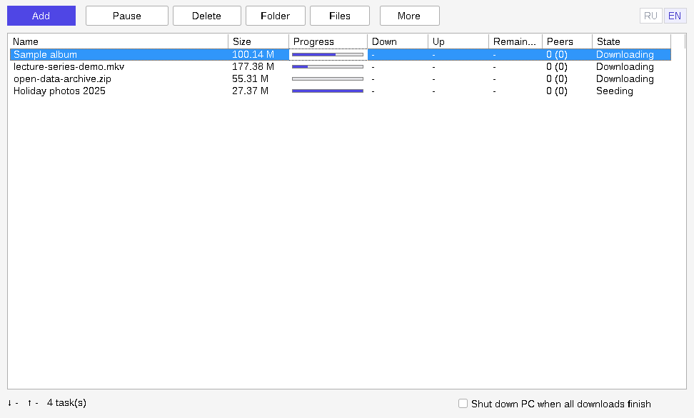

<p align="center"></p>

# LiteTorrent

**English** · [Русский](README.ru.md)

A deliberately small BitTorrent client for Windows: one 9.5 MB `.exe`, no installer, no ads, no settings screen, and a checkbox that shuts the PC down when the downloads are done.



> The screenshots were taken under Wine on Linux, so fonts and window frames look slightly different on real Windows.

## Download

Get `LiteTorrent-Windows-x64.zip` from the [Releases](../../releases) page, unpack it and run `litetorrent.exe`. Nothing else is needed next to it.

- Windows 10 or 11, 64-bit.
- The exe is **not code-signed**. SmartScreen will warn about an unknown publisher; choose "More info" → "Run anyway" if you trust this build, or build it yourself (see [Building](#building)).
- SHA-256 of the released exe is listed in the release notes.

## What it does

- Adds torrents from a magnet link, a `.torrent` file, drag-and-drop onto the window, or "Open with" / double-click in Explorer (the file path is taken from the command line). If LiteTorrent is already running, the second launch hands the file to the open window and quits, so there is never more than one window.
- **Remembers your torrents between runs.** The list, progress and paused state are saved when you close the app (and once a minute), and restored on the next start; nothing is re-checked from scratch.
- Lets you choose the save folder when adding, and remembers the last one.
- Shows name, size, progress, download and upload speed, time remaining, peers (seeds) and state.
- Pause / resume and delete (with or without the downloaded files) for the selected torrent.
- **Shut down the PC when all downloads finish**, with a 15-second countdown in a prominent always-on-top window with a "Cancel shutdown" button. A torrent with an error (for example, the disk is full) never counts as finished: the PC will not shut down because of it, and the status bar says why.
- Scales to the screen: sizes follow the Windows display scale (100–200 % and beyond), per monitor.
- Shows "Checking files" and "Fetching metadata" states, tells you when a torrent is already in the list, and the Folder button opens the selected torrent's own folder.
- Russian and English interface, switched by the RU / EN buttons in the top-right corner.

## What it does not do — read this before relying on it

This is a small project and it is honest about its limits:

- **Lightly tested.** The author downloaded torrents with version 1.0 on Windows; version 1.1 has not yet been tried on real Windows by the author. Beyond that, the builds were only checked under Wine: startup, adding torrents from the command line, a second launch handing over to the first, saving and restoring the list across restarts, the add dialog, the delete dialog, the shutdown countdown window and its Cancel button, language switching, 200 % display scale, and hash-checking existing data up to "Seeding". The "does not shut down on error" rule and the multi-monitor DPI change were written but not exercised. There is no automated test suite. Please report what you find.
- No choice of individual files inside a torrent, no priorities, no queueing, no scheduler.
- No speed-limit controls in the interface (see [Hidden settings](#settings-and-where-they-are-stored)).
- Not registered as the system handler for `.torrent` files or `magnet:` links: pick it once via "Open with" (magnet links from a browser do not open it).
- No tray icon, no notifications, no auto-update, no portable-mode switch.
- No proxy, VPN binding, or anonymous mode. **Your IP address is visible to peers and trackers**, as with any ordinary BitTorrent client.
- Left out of the engine to save space: I2P, WebTorrent, super-seeding, share mode, streaming (piece deadlines), BEP 38 mutable torrents, and libtorrent's logging.

## Network behaviour

Nothing is hidden here either. The app talks only BitTorrent; there is no telemetry, no analytics, no ads and no update check.

| Setting | Value |
|---|---|
| DHT, Local Service Discovery | on |
| UPnP and NAT-PMP | on — the app asks your router to forward its listening port |
| Listening port, protocol encryption, connection limits | libtorrent defaults |
| TCP / uTP mixed mode | `prefer_tcp` |
| Seeding | yes — finished torrents keep uploading until paused, deleted, or the app is closed |
| HTTPS trackers and web seeds | supported (OpenSSL is linked in) |
| User agent | `LiteTorrent/1.1.0` |

## Settings and where they are stored

Settings live in the registry under `HKEY_CURRENT_USER\Software\LiteTorrent`. The torrent list is stored as one small `.resume` file per torrent in `%LOCALAPPDATA%\LiteTorrent\torrents`. Nothing is written anywhere else, apart from the files you download. To remove every trace of the app, delete the exe, that registry key and the `%LOCALAPPDATA%\LiteTorrent` folder.

| Value | Type | Meaning |
|---|---|---|
| `DownloadDir` | string | Last chosen save folder (default: your Downloads folder) |
| `Language` | string | `ru` or `en` |
| `ShutdownWhenFinished` | DWORD | Last state of the shutdown checkbox (the box itself always starts unticked) |
| `DownloadLimitKBs`, `UploadLimitKBs` | DWORD | Speed limits in kB/s, `0` = unlimited. No interface for these; edit by hand and restart |
| `WaitForSeedingToFinish` | DWORD | `1` makes the shutdown feature wait while anything is still seeding. No interface |

Shutting down uses the standard `ExitWindowsEx` call, which closes other programs the normal way; unsaved work in other apps is at risk exactly as with a normal shutdown.

## How it is built

- **Language:** C++17, about 2,700 lines.
- **Interface:** plain Win32 API with the standard common controls. No Qt, no .NET, no Electron, no web view.
- **Engine:** [libtorrent](https://github.com/arvidn/libtorrent) 2.0.11, compiled from source with unused features switched off.
- **TLS / hashing:** OpenSSL 3.6.5, static.
- **Headers only:** Boost 1.92.
- Everything is linked statically into one exe with unused code removed (`-Os`, `--gc-sections`, stripped). It depends only on DLLs that ship with Windows.

Roughly where the 9.5 MB goes: OpenSSL 5.6 MB, libtorrent 3.6 MB, C++ runtime 1.0 MB, the app itself well under 0.5 MB.

Earlier iterations used Qt 6 and weighed 93 MB unpacked; dropping Qt brought that to 20 MB, and static linking with a trimmed engine to 9.5 MB.

### Source layout

| File | Role |
|---|---|
| `src/main.cpp` | Entry point, single-instance hand-over, message loop |
| `src/MainWindow.*` | The window: toolbar, list, status bar, timers, drag-and-drop |
| `src/TorrentListView.*` | Wrapper around the native list control, in-place row updates, progress bar |
| `src/AddTorrentDialog.*` | "Add torrent" dialog |
| `src/SessionManager.*` | The only code that touches libtorrent |
| `src/ShutdownManager.*` | Countdown and shutdown |
| `src/CountdownDialog.*` | The always-on-top countdown window with the Cancel button |
| `src/AppSettings.*` | Registry access |
| `src/Localization.*` | RU / EN string table |
| `resources/` | Icon, version info, application manifest |

## Building

The released exe was cross-compiled on Linux (Debian's MinGW-w64, GCC 13, posix threads). `build.sh` repeats that build (the result is functionally the same but not byte-identical, because the exe embeds a build timestamp):

```sh
sudo apt install g++-mingw-w64-x86-64-posix cmake ninja-build git
SYSROOT=/path/to/mingw64 ./build.sh
```

`SYSROOT` must contain Boost headers and OpenSSL static libraries built for MinGW-w64 x86_64. The release used the MSYS2 packages `mingw-w64-x86_64-boost` 1.92.0-4 and `mingw-w64-x86_64-openssl` 3.6.5-1, unpacked. The script downloads libtorrent itself, builds it, then builds and links the app into `build/litetorrent.exe`.

Building natively on Windows with MSYS2 should work with the same flags but has not been tried.

## How this was made

The author of this repository is not a programmer. The code was written by Claude, an AI model made by Anthropic, working from the author's requirements and feedback over a series of iterations. Treat it accordingly: read the source before trusting it, and expect rough edges.

## Legal

LiteTorrent is a general-purpose file-transfer tool. You are responsible for what you download and share with it; use it only for content you have the right to distribute. The skull-and-crossbones icon is a joke, not an invitation.

## License

LiteTorrent's own code is released under the [MIT License](LICENSE).

The released exe also contains libtorrent (BSD 3-Clause), OpenSSL (Apache 2.0), Boost (Boost Software License 1.0), and the GCC / MinGW-w64 runtime libraries. See [THIRD-PARTY-NOTICES.md](THIRD-PARTY-NOTICES.md).
