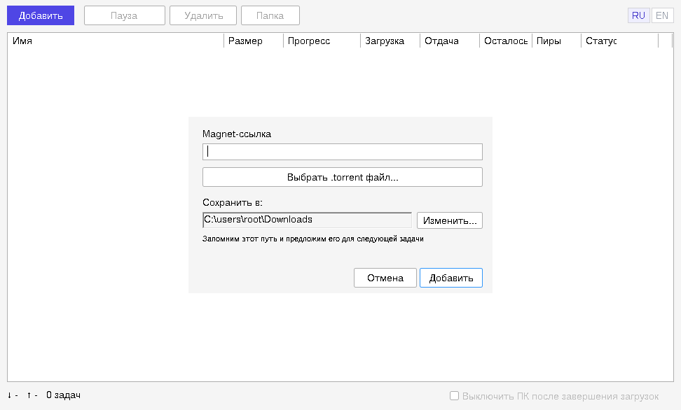

<p align="center"></p>

# LiteTorrent

[English](README.md) · **Русский**

Намеренно маленький торрент-клиент для Windows: один `.exe` на 9,5 МБ, без установщика, без рекламы, без экрана настроек и с галочкой «выключить компьютер, когда загрузки закончатся».



> Снимки экрана сделаны под Wine в Linux, поэтому шрифты и рамки окон на настоящей Windows выглядят немного иначе.

## Скачать

Возьмите `LiteTorrent-Windows-x64.zip` на странице [Releases](../../releases), распакуйте и запустите `litetorrent.exe`. Других файлов рядом не нужно.

- Windows 10 или 11, 64-бит.
- Файл **не подписан цифровой подписью**. SmartScreen предупредит о неизвестном издателе; нажмите «Подробнее» → «Выполнить в любом случае», если доверяете этой сборке, либо соберите программу сами (см. [Сборка](#сборка)).
- Начиная с 1.2.0, релизы собирает [GitHub Actions](../../actions) прямо из помеченного коммита этого репозитория, а не чей-то личный компьютер. В описании релиза есть ссылка на журнал сборки и SHA-256 exe, так что можно проверить, что скачанный файл — тот самый, который получился в этом журнале.

## Что умеет

- Добавляет торренты по magnet-ссылке, из файла `.torrent`, перетаскиванием на окно, а также через «Открыть с помощью» или двойной щелчок в Проводнике (путь к файлу берётся из командной строки).
- **Сама открывает файлы `.torrent` и ссылки `magnet:`, если вы хотите.** При первом запуске программа спрашивает об этом один раз; ответ можно изменить в меню **Ещё**. Регистрация только для вашего пользователя Windows, без прав администратора. Если их уже открывает другая программа, Windows не позволяет перехватить это молча: LiteTorrent сообщит об этом и предложит открыть «Параметры → Приложения по умолчанию».
- **Выбор файлов.** Выделите торрент и нажмите **Файлы**, чтобы отметить или снять файлы; неотмеченные не скачиваются. Для magnet-ссылки список появится, когда придут метаданные. Выбор сохраняется вместе с торрентом.
- **Ограничение скорости.** **Ещё** → «Ограничить загрузку» / «Ограничить отдачу», несколько готовых значений от 512 KB/s до 20 MB/s (отдача — от 64 KB/s). Действующее ограничение видно в строке состояния рядом со скоростью.
- При добавлении даёт выбрать папку сохранения и запоминает последнюю.
- Показывает имя, размер, прогресс, скорость загрузки и отдачи, оставшееся время, число пиров (сидов) и статус.
- Пауза, возобновление и удаление (с файлами или без) для выбранного торрента; «Папка» открывает папку, куда сохранён именно он.
- **Помнит список задач.** Торренты, их прогресс и состояние паузы сохраняются при закрытии программы, перезагрузке и сбое (прогресс записывается раз в минуту и при выходе).
- **Одна работающая копия.** Если открыть ещё один `.torrent`, когда LiteTorrent уже запущен, он добавится в существующее окно, а вторая программа не запустится. При добавлении торрента, который уже есть в списке, программа об этом сообщает.
- **Выключает компьютер, когда все загрузки завершены.** Окно в центре экрана поверх всех окон отсчитывает 15 секунд, в нём есть кнопка «Отменить выключение». Срабатывает только для загрузок, которые ещё шли после того, как вы поставили галочку — если поставить её при уже готовом списке, ничего не произойдёт, — и никогда, пока какой-то торрент остановлен с ошибкой.
- Интерфейс на русском и английском, переключается кнопками RU / EN в правом верхнем углу.

## Чего не умеет — прочитайте, прежде чем полагаться на программу

Проект маленький, и его ограничения названы прямо:

- **Проверена слабо.** Автор пользовался версиями 1.0 и 1.1 в Windows. Новое в 1.2 проверялось только под Wine: вопрос при первом запуске, запись и удаление регистрации, magnet-ссылка, открытая через оболочку Windows и попавшая в открытое окно, окно «Файлы» (снятие файла, сохранение выбора после перезапуска), меню «Ещё» и ограничение скорости, сообщение о повторном торренте. Как «Приложения по умолчанию» Windows 10/11 отнесутся к регистрации, под Wine не проверить — эта часть не проверена. Автоматических тестов нет. Сообщайте о найденном.
- Файлы можно только скачивать или пропускать: нет приоритетов, своей очереди и расписания. Файлы выбираются после добавления торрента, поэтому в первые секунды могут скачаться части файлов, которые вы потом снимете.
- Ограничения скорости — готовые значения, а не произвольные числа (любое значение можно задать в реестре, см. ниже).
- Нет значка в трее, уведомлений, автообновления и «портативного» режима.
- Одновременно скачиваются не более трёх торрентов (значение libtorrent по умолчанию); остальные показываются как «В очереди» и стартуют сами.
- Нет прокси, привязки к VPN и анонимного режима. **Ваш IP-адрес виден пирам и трекерам**, как в любом обычном торрент-клиенте.
- Из движка ради размера убраны: I2P, WebTorrent, суперсид, share mode, потоковый режим (сроки для частей), изменяемые торренты (BEP 38) и журналирование libtorrent.

## Поведение в сети

Здесь тоже ничего не скрыто. Программа общается только по протоколу BitTorrent: нет телеметрии, аналитики, рекламы и проверки обновлений.

| Параметр | Значение |
|---|---|
| DHT, поиск пиров в локальной сети (LSD) | включены |
| UPnP и NAT-PMP | включены — программа просит роутер пробросить её входящий порт |
| Входящий порт, шифрование протокола, лимиты соединений | значения libtorrent по умолчанию |
| Смешанный режим TCP / uTP | `prefer_tcp` |
| Раздача | да — завершённые торренты продолжают раздаваться, пока их не поставить на паузу, не удалить или не закрыть программу |
| Трекеры и веб-сиды по HTTPS | поддерживаются (OpenSSL вшит в exe) |
| User agent | `LiteTorrent/1.2.0` |

## Настройки и где они хранятся

Настройки лежат в реестре, в ветке `HKEY_CURRENT_USER\Software\LiteTorrent`. Список задач хранится в `%APPDATA%\LiteTorrent\resume` — по одному небольшому файлу `.fastresume` на торрент (его метаданные, папка сохранения, состояние паузы и перечень готовых частей). Больше программа никуда ничего не пишет, кроме самих скачиваемых файлов. Если вы включили открытие `.torrent` / `magnet:` в LiteTorrent, программа также пишет в `HKEY_CURRENT_USER\Software`: `Classes\LiteTorrent.torrent`, `Classes\LiteTorrent.magnet`, `Classes\.torrent` (значение по умолчанию и `OpenWithProgids`), `Classes\magnet` (только если его не занимала другая программа) и значение `LiteTorrent` в `RegisteredApplications`; если выключить эту возможность в меню **Ещё**, всё это удаляется. Чтобы убрать все следы, выключите её, затем удалите exe, эту ветку реестра и эту папку.

| Параметр | Тип | Смысл |
|---|---|---|
| `DownloadDir` | строка | Последняя выбранная папка сохранения (по умолчанию — «Загрузки») |
| `Language` | строка | `ru` или `en` |
| `ShutdownWhenFinished` | DWORD | Последнее состояние галочки выключения (сама галочка при запуске всегда снята) |
| `DownloadLimitKBs`, `UploadLimitKBs` | DWORD | Ограничение скорости в КиБ/с (1 КиБ = 1024 байта), `0` — без ограничения. Задаётся в меню «Ещё»; любое другое значение можно вписать здесь вручную (действует со следующего запуска) |
| `FileAssociation` | DWORD | `1` — открывать `.torrent` / `magnet:` в LiteTorrent, `0` — нет, отсутствует — ещё не спрашивали |
| `WaitForSeedingToFinish` | DWORD | `1` — функция выключения ждёт, пока что-либо ещё раздаётся. В интерфейсе нет |

Выключение выполняется стандартным вызовом `ExitWindowsEx`, который закрывает остальные программы обычным образом; несохранённая работа в них под тем же риском, что и при обычном выключении.

## Как это устроено

- **Язык:** C++17, около 3500 строк.
- **Интерфейс:** чистый Win32 API со стандартными элементами управления, с учётом масштаба каждого монитора (размеры и шрифты следуют масштабу экрана). Без Qt, .NET, Electron и встроенного браузера.
- **Движок:** [libtorrent](https://github.com/arvidn/libtorrent) 2.0.11, собранный из исходников с отключением неиспользуемых возможностей.
- **TLS и хеширование:** OpenSSL 3.6.5, статически.
- **Только заголовки:** Boost 1.92.
- Всё слинковано статически в один exe с удалением неиспользуемого кода (`-Os`, `--gc-sections`, без отладочных символов). Нужны только DLL, входящие в состав Windows.

Примерно из чего складываются 9,5 МБ: OpenSSL — 5,6 МБ, libtorrent — 3,6 МБ, среда выполнения C++ — 1,0 МБ, сама программа — заметно меньше 0,5 МБ.

Ранние версии были на Qt 6 и занимали 93 МБ в распакованном виде; отказ от Qt дал 20 МБ, а статическая линковка с урезанным движком — 9,5 МБ.

### Структура исходников

| Файл | Назначение |
|---|---|
| `src/main.cpp` | Точка входа, разбор командной строки, цикл сообщений |
| `src/MainWindow.*` | Окно: панель кнопок, список, строка состояния, таймеры, перетаскивание |
| `src/TorrentListView.*` | Обёртка над системным списком, обновление строк на месте, полоса прогресса |
| `src/AddTorrentDialog.*` | Окно «Добавить торрент» |
| `src/FilesDialog.*` | Окно «Файлы»: какие файлы торрента скачивать |
| `src/Associations.*` | Регистрация программы для файлов `.torrent` и ссылок `magnet:` |
| `src/SessionManager.*` | Единственный код, который обращается к libtorrent |
| `src/ShutdownManager.*` | Отсчёт и выключение |
| `src/AppSettings.*` | Работа с реестром |
| `src/Localization.*` | Таблица строк RU / EN |
| `resources/` | Иконка, сведения о версии, манифест приложения |
| `.github/workflows/build.yml`, `ci/` | Автоматическая сборка на GitHub и её скрипты |
| `release-notes/` | Текст каждого релиза на GitHub |

## Сборка

Релизы собирает GitHub Actions кросс-компиляцией в Linux (Ubuntu 24.04, MinGW-w64 GCC 13, потоки posix), см. `.github/workflows/build.yml`. Архив собирается и при каждом обновлении кода: откройте запуск на вкладке Actions и скачайте его в разделе «Artifacts». Чтобы собрать на своём Linux, повторите шаги этой сборки (результат функционально тот же, но не совпадает байт в байт: в exe записывается время сборки):

```sh
sudo apt install g++-mingw-w64-x86-64-posix cmake ninja-build git zstd zip
ci/fetch-sysroot.sh /tmp/sysroot          # Boost и OpenSSL, с проверкой контрольных сумм
SYSROOT=/tmp/sysroot/mingw64 ./build.sh   # -> build/litetorrent.exe
ci/package.sh                             # -> dist/LiteTorrent-Windows-x64.zip
```

`ci/fetch-sysroot.sh` скачивает пакеты MSYS2 `mingw-w64-x86_64-boost` 1.92.0-4 и `mingw-w64-x86_64-openssl` 3.6.5-1 с repo.msys2.org и проверяет их SHA-256 перед распаковкой. `build.sh` сам скачивает libtorrent 2.0.11, собирает его, затем собирает и линкует программу. Если в вашем дистрибутиве `x86_64-w64-mingw32-g++` по умолчанию с потоками win32, переключите его на вариант posix (`update-alternatives`), как это делает сборка на GitHub.

Сборка прямо в Windows через MSYS2 с теми же флагами должна работать, но не проверялась.

## Как это сделано

Автор репозитория не программист. Код написан Claude — ИИ-моделью компании Anthropic — по требованиям и замечаниям автора за несколько итераций. Относитесь к нему соответственно: прочитайте исходники, прежде чем доверять, и ожидайте шероховатостей.

## Правовая сторона

LiteTorrent — инструмент общего назначения для передачи файлов. За то, что вы скачиваете и раздаёте, отвечаете вы сами; используйте программу только для материалов, которые вправе распространять. Череп с костями на иконке — шутка, а не приглашение.

## Лицензия

Собственный код LiteTorrent распространяется по [лицензии MIT](LICENSE).

В выложенный exe также входят libtorrent (BSD 3-Clause), OpenSSL (Apache 2.0), Boost (Boost Software License 1.0) и библиотеки времени выполнения GCC / MinGW-w64. См. [THIRD-PARTY-NOTICES.md](THIRD-PARTY-NOTICES.md).
